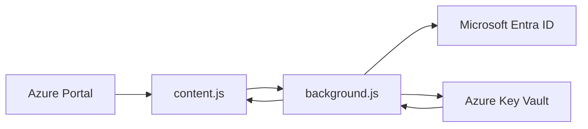

# Azure Key Vault Secret Revealer

A Chromium extension that adds inline Azure Key Vault secret values to the Azure Portal secret grids.

It can:

- reveal secret values directly in the Azure Portal list and version views;
- load the full secret list automatically, without clicking `Load more` repeatedly;
- filter the secret list with a search box and sort it by clicking the `Name` header;
- show secret version creation dates in the versions view;
- edit the current value and create a new secret version;
- create a brand-new secret from a slide-down panel that replaces the portal's native new-secret button;
- export and import current secret values with a plain JSON file and an import preview;
- keep older secret versions read-only;
- authenticate with Microsoft sign-in or a temporary pasted Key Vault access token.

This project is intended for users who already have valid Azure RBAC access to the target Key Vault. It does not bypass Azure permissions.

## Access Model

The extension cannot read, list, or update secrets by itself. Without a valid Microsoft Entra user session or pasted Key Vault access token, it is non-operable.

Access depends on all of the following:

- a valid Microsoft Entra identity or temporary bearer token;
- Azure RBAC data-plane permissions on the watched Key Vault;
- network access from the browser environment to Azure Portal and the target Key Vault endpoint.

If the signed-in user cannot access a vault in Azure, the extension cannot access it either.

## Safety Notice

This extension displays and edits secrets. Treat it as privileged tooling.

- Revealed secret values are visible in the page, screenshots, browser accessibility trees, and potentially screen-sharing sessions.
- Exported JSON files contain plaintext secret values. Store and delete them with the same care as any other secret backup.
- Any user who can use this extension with your browser profile may be able to reveal secrets that your Azure identity can access.
- Editing the current value creates a new Key Vault secret version. It does not modify historical versions.
- Importing an existing name creates a new active Key Vault secret version.
- Older versions are immutable in Azure Key Vault and are shown read-only by this extension.
- Use least privilege. Grant read/write permissions only to users who truly need them.
- Review your organization's policy before using browser extensions with production secrets.

## Features

### Secret List View

On a Key Vault secrets list page, the extension injects a `Value` column next to the secret name.

When hidden, values are masked.

When revealed, each secret value is fetched from Key Vault and shown in an input. If you edit the current value, a subtle green check button appears at the end of the input. Pressing that button saves the value as a new secret version.

### Create Secret Panel

On the secrets list, the extension hides the portal's native `Generate/Import` command and puts a `Create secret` command in its place. Clicking it slides down a panel with a secret name input, a secret value input, and a `Create` button in a single row.

`Create` validates the name, warns if a loaded row already uses it (a plain create would silently add a new version), then creates the secret via the Key Vault data-plane API. On success the panel closes and the list refreshes automatically. Creating secrets requires `secrets/set` permission.

The native button is hidden, not removed; it comes back when the extension UI is removed from the page.

### Import and Export Secrets

On the secrets list, the extension adds `Export secrets` and `Import secrets` commands.

`Export secrets` lists the active vault, fetches every current secret value, and downloads a plain JSON file only if every value is fetched successfully. It does not create a partial file when any secret fails.

`Import secrets` reads an export JSON file, validates its schema, shows source and destination vault names, and summarizes how many imported names are new versus existing. Before confirmation, choose whether existing names receive new active versions or are skipped.

Export files use this shape:

```json
{
  "format": "azkv-secret-export",
  "version": 1,
  "sourceVault": "example-vault",
  "exportedAt": "2026-07-10T20:00:00.000Z",
  "secrets": [
    {
      "name": "example-secret",
      "value": "plaintext secret value"
    }
  ]
}
```

### Automatic Full List Loading

The Azure Portal loads large secret lists in pages and requires clicking `Load more` repeatedly. The extension clicks the portal's `Load more` control automatically until every secret is loaded, so the full list appears without user intervention.

The auto-loader is scoped to the current blade, throttles its clicks, and stops on its own if clicking no longer adds rows. It works on both the secrets list and a secret's versions view. While pages load, the extension pins the scroll position so the view does not jump toward the newly loaded rows.

### Search by Secret Name

A search box appears above the secrets list, aligned to the right. Typing filters the loaded rows to secrets whose name contains the text, case-insensitively. A counter next to the box shows how many secrets match (`N of M`), or the total number of loaded secrets when the box is empty.

Press `Escape` or use the input's clear button to reset the filter.

### Sort by Secret Name

Click the `Name` column header to sort the secrets list by name: first click sorts ascending, second descending, third restores the original portal order. An arrow in the header shows the current direction.

Sorting is client-side and reorders only the rows already loaded, so combined with automatic full list loading it covers the whole vault.

### Secret Versions View

On a single secret's versions page, the extension injects:

- `Value`
- `Created date`

The current version is editable. Older versions are read-only and include a tooltip explaining that older versions cannot be changed.

### Toolbar Toggle

The extension adds a `Show Key Vault Secret Values` button to the Azure Portal command bar. Press it again to hide values.

### Authentication

The popup supports two auth modes:

- Microsoft sign-in using the extension's Entra application registration.
- Advanced fallback: paste a temporary Key Vault access token from Azure CLI.

## How It Works

The extension has three main parts:

- `manifest.json`: declares extension permissions, host access, popup, background worker, and content script.
- `background.js`: handles authentication and calls the Azure Key Vault data-plane API.
- `content.js`: detects Azure Portal Key Vault grids, auto-loads all rows, injects columns, the search box, and the create-secret panel, handles name sorting, renders values, and sends fetch/save requests to the background worker.

Data flow:



The extension calls:

- `GET https://{vault}.vault.azure.net/secrets/{secretName}?api-version=7.4`
- `GET https://{vault}.vault.azure.net/secrets/{secretName}/{version}?api-version=7.4`
- `GET https://{vault}.vault.azure.net/secrets?api-version=7.4`
- `PUT https://{vault}.vault.azure.net/secrets/{secretName}?api-version=7.4`

The `PUT` call creates the secret when the name is new, or a new version of an existing secret.

## Requirements

- Google Chrome, Microsoft Edge, or another Chromium browser that supports Manifest V3.
- Access to `https://portal.azure.com`.
- Network access to the target Key Vault endpoint, including any firewall or private endpoint requirements.
- Azure Key Vault data-plane permissions for the signed-in Microsoft Entra user or pasted token.
- An Entra application registration for OAuth sign-in, unless you only use pasted temporary tokens.

## Azure Permissions

The extension uses delegated user permissions. It cannot independently discover, list, read, or write Key Vault secrets without an authenticated user or token that Azure accepts.

For reveal-only usage, the user needs permission to read secret values, such as:

- `secrets/get`
- `secrets/list`

Export requires both `secrets/list` and `secrets/get`.

For creating secrets, editing current values, creating new versions, and importing secrets, the user also needs:

- `secrets/set`

Common built-in RBAC roles:

- `Key Vault Secrets User`: read secret contents.
- `Key Vault Secrets Officer`: manage secrets, including setting new values.

Use the narrowest role and scope that works. Prefer Key Vault-level or resource-group-level scope over subscription-level scope when possible.

## Entra App Registration Setup

The extension uses OAuth Authorization Code Flow with PKCE through `chrome.identity.launchWebAuthFlow`.

1. Go to Microsoft Entra ID in the Azure Portal.
2. Open `App registrations`.
3. Create a new app registration.
4. Use a public-client style registration. Do not create or use a client secret.
5. Add one redirect URI per extension ID in use (see [Extension ID](#extension-id)):

   ```text
   https://aobcnpejfheeceefeejkogdonmhndhcn.chromiumapp.org/
   https://<store-extension-id>.chromiumapp.org/
   ```

   The extension sends `chrome.identity.getRedirectURL()`, which is `https://<extension-id>.chromiumapp.org/` for the running build.

6. Copy the Application client ID.
7. Set `CLIENT_ID` in `background.js`.

```js
const CLIENT_ID = "YOUR_APPLICATION_CLIENT_ID";
```

The current code uses:

```js
const TENANT_ID = "organizations";
const KEY_VAULT_SCOPE = "https://vault.azure.net/.default";
```

`organizations` allows work or school accounts. It is only the starting authority; see below for how vaults in other tenants are handled.

### Vaults in Multiple Tenants

Key Vault's data plane is tenant-bound. A vault only accepts an access token issued by the tenant that owns it, and rejects anything else with HTTP 401 regardless of your RBAC assignments. A single fixed authority therefore cannot serve vaults in two tenants.

The extension resolves the tenant per vault:

1. The first call to an unknown vault uses the `organizations` authority.
2. If the vault rejects that token, it replies with `WWW-Authenticate: Bearer authorization="https://login.windows.net/<tenant-id>"`, naming the tenant it requires.
3. The extension re-acquires a token from that tenant and retries the call once.
4. The vault-to-tenant mapping is cached in `chrome.storage.local` under `kvVaultTenantMap`, so later calls go straight to the right authority.

Access tokens are cached per tenant in memory. The refresh token is bound to your account rather than to one tenant, so switching tenants is usually silent and needs no extra sign-in.

To use a second tenant, the app registration must be multi-tenant (`Accounts in any organizational directory`) **and** have a service principal in that tenant. The service principal is created the first time someone consents to the app there.

Many tenants only allow user consent for apps from verified publishers. This app is unverified, so signing in shows `Approval required` with a justification box instead of a consent button. Enter a justification and submit it; an administrator then approves it under `Microsoft Entra ID` > `Enterprise applications` > `Admin consent requests`. That single approval creates the service principal and the extension works from then on.

An administrator can also consent directly. The admin consent endpoint requires a `redirect_uri` that is already registered on the app registration, otherwise it fails with `AADSTS90097`:

```text
https://login.microsoftonline.com/<second-tenant-id>/v2.0/adminconsent
  ?client_id=<your-client-id>
  &scope=https://vault.azure.net/.default openid profile offline_access
  &redirect_uri=https://aobcnpejfheeceefeejkogdonmhndhcn.chromiumapp.org/
```

Join it into one line and URL-encode the `scope` value. The administrator must hold Global Administrator, Privileged Role Administrator, or Cloud Application Administrator in that tenant; a normal user or a guest cannot grant admin consent.

If a silent cross-tenant token cannot be obtained, the popup keeps its `Sign-in` button visible and explains which tenant is needed. Clicking it signs you in directly against that tenant. This is the path to use when each tenant has a separate account rather than one guest account.

### Extension ID

There are two IDs:

| Build | ID | Source |
|---|---|---|
| Unpacked from this repo, or `bin/azkvextension.crx` | `aobcnpejfheeceefeejkogdonmhndhcn` | `key` field in `manifest.json` (public key of `bin/azkvextension.pem`) |
| Chrome Web Store | assigned by the store on first upload | the store's own signing key |

The store rejects a manifest with a `key` field, so `node scripts/package.mjs` removes it from the packaged copy. The repo manifest keeps `key` so unpacked installs keep the ID that is already registered as a redirect URI. Do not remove `key` from the repo manifest unless you replace it (see below).

Each ID needs its own redirect URI on the app registration. To give unpacked builds the store ID instead, so one redirect URI covers both:

1. In the Chrome Web Store Developer Dashboard, open the item, go to `Package`, and click `View public key`.
2. Copy the base64 text between the `BEGIN PUBLIC KEY` and `END PUBLIC KEY` lines and join it into one line.
3. Replace the `key` value in `manifest.json` with it. Unpacked builds now get the store ID. The package script still strips it.
4. Remove the `aobcnpejfheeceefeejkogdonmhndhcn` redirect URI once nobody uses the old unpacked or `.crx` build.

Changing the ID clears the extension's stored sign-in and vault-to-tenant map. Users sign in again once.

Keep `bin/azkvextension.pem` private and out of version control. It is the signing key for the `.crx`. Anyone with it can publish an update that Chrome accepts as this extension.

Verify the ID after loading:

1. Open `chrome://extensions` or `edge://extensions`.
2. Enable developer mode.
3. Find this extension.
4. Confirm the ID matches the value above.

## Install Locally

1. Clone or download this repository.
2. Open `chrome://extensions` or `edge://extensions`.
3. Enable `Developer mode`.
4. Click `Load unpacked`.
5. Select this project folder.
6. Configure `CLIENT_ID` in `background.js`.
7. Reload the extension after changing code.

## Sign In

1. Open the extension popup.
2. Click `Sign-in`.
3. Complete Microsoft sign-in.
4. The active Azure Portal tab reloads after auth updates.

If sign-in is not configured, the popup shows:

```text
Configure CLIENT_ID in background.js before signing in.
```

## Temporary Token Mode

The popup has an advanced option to paste a temporary Key Vault token.

Generate one with Azure CLI:

```powershell
az account get-access-token --resource https://vault.azure.net --query accessToken -o tsv
```

Paste it into the popup and click `Use pasted token`.

Notes:

- This is a fallback for local testing or special environments.
- The token is stored in `chrome.storage.session`.
- The popup text says the token is valid for about 30 minutes.
- Clear it from the popup when you are done.

## Usage Guide

### Reveal Secret Values

1. Open the Azure Portal.
2. Navigate to a Key Vault.
3. Open `Secrets`.
4. Click `Show Key Vault Secret Values` in the command bar.
5. Wait for values to load.

If a value cannot be fetched, the injected cell shows an error such as:

- `[Access denied]`
- `[Secret not found]`
- `[Token rejected: <Key Vault message>]`
- `[Wrong tenant for this vault: token from <tenant-id>, vault needs <tenant-id>]`
- `[Sign in required for tenant <tenant-id>]`
- `[Key Vault request timed out]`

### Hide Secret Values

Click `Hide Key Vault Secret Values`.

This masks the injected values in the grid. It does not revoke Azure tokens or clear all browser memory. To fully stop access, sign out from the popup or close the browser session.

### Search and Sort the Secret List

All secrets load automatically when the list opens. Use the search box above the grid to filter by name. Click the `Name` header to cycle ascending, descending, and original order.

### Resize the Value Column

The injected `Value` column has a resize handle in the header. Drag it to widen or shrink the column.

### Create a New Secret

1. Open the `Secrets` list.
2. Click `Create secret` in the command bar (it replaces the native `Generate/Import` button).
3. Type the secret name and value in the slide-down panel.
4. Click `Create` or press `Enter`.

The panel shows `Creating...`, then `Created`, then closes and refreshes the list. Errors (invalid name, duplicate name, access denied) appear inline. Press `Escape` to close the panel without creating.

### Create a New Secret Version

1. Reveal values.
2. Edit the current value input.
3. A green check appears at the end of the input.
4. Click the green check.
5. The extension calls Key Vault to create a new version.

The control shows:

- `Saving...`
- `Saved`
- or an error message

### Export Secrets

1. Open the `Secrets` list.
2. Click `Export secrets` in the command bar.
3. Read the plaintext-file warning.
4. Wait for listing and value fetch progress to finish.
5. Store the downloaded JSON file securely.

If any secret cannot be fetched, the extension reports the failed names and does not download a partial file.

### Import Secrets

1. Open the destination vault's `Secrets` list.
2. Click `Import secrets` in the command bar.
3. Select an export JSON file.
4. Review the preview, including source vault, destination vault, new names, and existing names.
5. Select `Replace existing values` or `Skip existing secrets`.
6. Click `Import` to write the selected values.

Replacing does not overwrite a historical version in place. Key Vault creates a new active version for each existing imported name. Skip mode imports only names that do not exist in the destination vault. Import errors are reported per secret, and the list is refreshed after the write attempt.

### Older Versions

Older versions are read-only. Azure Key Vault does not allow editing the value of an existing secret version.

To restore or reuse an older value:

1. Copy the older value.
2. Edit the current version value.
3. Save it as a new version.

## What Is Stored

The extension stores auth-related data, not secret values.

OAuth mode:

- Refresh token and account metadata are stored in `chrome.storage.local`.
- Access token is cached in the background service worker memory.

Temporary token mode:

- Pasted token is stored in `chrome.storage.session`.

Secret values:

- Values are fetched from Key Vault and rendered into the Azure Portal DOM when revealed.
- Values are cached in memory by the content script to avoid repeated fetches during the page session.
- Exported values are written only to the user-downloaded JSON file.
- Imported values are read from the selected file and sent to Key Vault; they are not intentionally written to extension local storage.
- A secret's cached values are dropped when you leave its versions view, so new versions created there (inline or with the portal's `New Version` flow) show up in the list immediately.
- Values are not intentionally written to extension local storage.

## Browser Permissions

The manifest requests:

- `storage`: store auth state and temporary token state.
- `identity`: run Microsoft sign-in through browser identity APIs.

Host permissions:

- `https://portal.azure.com/*`: inject UI into Azure Portal, and let the popup see that the active tab is the portal so it can reload it after auth changes.
- `https://*.vault.azure.net/*`: call Key Vault data-plane APIs.
- `https://login.microsoftonline.com/*`: request OAuth tokens.

## Security Concerns

### Secret Exposure

Once revealed, secret values are plain text in the page. They can be seen by:

- anyone looking at the screen;
- screen-sharing software;
- screenshots;
- browser accessibility tools;
- potentially other extensions with broad page access.

Keep values hidden unless needed.

### Export Files

Export files are plaintext secret backups. Do not attach them to tickets, email them, commit them, or leave them in shared folders. Prefer short-lived local handling and secure deletion after use.

### Editing Production Secrets

Saving a changed value creates a new active version. Applications that read the latest version may start using it immediately.

Before editing production secrets:

- confirm the target vault and secret name;
- confirm the current value;
- confirm application rollout expectations;
- confirm rollback steps;
- verify audit logging is enabled.

### RBAC Scope

Do not grant broad subscription-level write permissions just for convenience.

Use least privilege:

- read-only users should not have `secrets/set`;
- writers should be scoped to only the vaults they manage;
- review access regularly.

### Browser Profile Risk

OAuth refresh tokens live in browser extension storage. Protect the browser profile with normal endpoint controls.

Recommended:

- use a managed device;
- keep browser and OS updated;
- avoid shared profiles;
- sign out when done;
- remove the extension when no longer needed.

### Manual Tokens

Pasted tokens are bearer tokens. Anyone with the token can use it until it expires.

Do not paste tokens into chat, tickets, docs, or logs.

## Troubleshooting

### Button Does Not Appear

Check:

- you are on `https://portal.azure.com`;
- you are on a Key Vault secrets page;
- the extension is loaded and enabled;
- the page was refreshed after installing or signing in.

Azure Portal DOM changes can break grid detection. If the portal layout changes, `content.js` may need updates.

### Needs Sign-In

Open the popup and sign in.

If the popup says the client is not configured, set `CLIENT_ID` in `background.js` and reload the extension.

### Invalid Extension Client ID

Check:

- the Entra app registration exists;
- `CLIENT_ID` matches the Application client ID;
- a redirect URI is registered for the ID of the build you run: `aobcnpejfheeceefeejkogdonmhndhcn` for unpacked builds, the store ID for store installs (see [Extension ID](#extension-id));
- for unpacked builds, the `key` field in `manifest.json` is intact, so the loaded ID matches that redirect URI;
- the redirect URI ends with `/`.

### Wrong Tenant For This Vault

The vault rejected the token because it was issued by a different tenant. Sign-in succeeding elsewhere does not help: Key Vault validates the issuing tenant before it looks at your permissions, which is why this appears as 401 rather than `Access denied`.

Open the popup. It names the tenant the vault requires and keeps the `Sign-in` button available; click it and complete sign-in against that tenant.

If sign-in ends on `Approval required`, that tenant restricts user consent to verified publishers and the app has no service principal there yet. Submit the approval request and have an administrator approve it, or have an administrator consent directly. See [Vaults in Multiple Tenants](#vaults-in-multiple-tenants) for both paths.

Until that approval lands, the pasted-token fallback reaches the other tenant without any consent, because the Azure CLI is already consented in most tenants:

```bash
az account get-access-token --tenant <second-tenant-id> --resource https://vault.azure.net --query accessToken -o tsv
```

Paste that into `Advanced: paste temporary token` in the popup. The extension uses it whenever it cannot get a token for a vault's tenant on its own, and it lasts about an hour.

To confirm the mismatch, compare the tenant that owns the vault against the `tid` claim of the token in use:

```bash
az keyvault show --name <vault-name> --query properties.tenantId -o tsv
```

The background service worker console also logs `[KV Ext] Vault requires another tenant:` with the tenant the vault asked for.

### Tenant Rejected The Extension (AADSTS Codes)

Errors from Entra now carry their `AADSTS` code, in the grid cell and in the popup. These codes come from the app registration or the tenant's policy, so signing in again does not clear them:

| Code | Meaning | Fix (admin) |
|---|---|---|
| `AADSTS7000119` | App registration's `Allow only certain tenants` list does not include this tenant | Add the tenant ID under app registration > `Authentication` > `Supported account types`, or allow all tenants |
| `AADSTS50194` | App registration is single-tenant | Set `Supported account types` to multiple Entra ID tenants |
| `AADSTS700016` | App has no service principal in this tenant | Grant admin consent in this tenant |
| `AADSTS65001`, `AADSTS90094`, `AADSTS90095` | Consent missing; users may not consent themselves | Grant admin consent, or approve the pending admin consent request |
| `AADSTS50105` | `Assignment required` is on and the user is not assigned | Assign the user or group to the enterprise app |
| `AADSTS53000`, `AADSTS53003` | Blocked by Conditional Access | Adjust the policy or use a compliant device |
| `AADSTS50020` | The account is not a member or guest of this tenant | Sign in with an account from this tenant, or invite the account as a guest |

When Entra shows the error on its own page, the sign-in window does not return it to the extension. Copy the error code and the `Troubleshooting details` (Request ID, Correlation ID, Timestamp) before closing the window.

### Access Denied

Your identity or pasted token does not have the needed Key Vault data-plane permission.

For reveal:

- check `secrets/get`;
- check `secrets/list` for export and import preview;
- check vault firewall and network restrictions;
- check tenant/account selection.

For save or import:

- check `secrets/set`.

### Import File Rejected

Check:

- the file is valid JSON;
- `format` is `azkv-secret-export`;
- `version` is `1`;
- every secret has a valid Key Vault secret name and string `value`;
- secret names are not duplicated case-insensitively.

### Token Rejected

The vault returned 401 for a token from its own tenant. The Key Vault message after `Token rejected:` gives the reason, such as an expired token. Sign in again or refresh the pasted token.

### Key Vault Request Timed Out

The extension times out network calls after 15 seconds. Retry after checking:

- network connectivity;
- vault firewall rules;
- private endpoint access;
- Azure service health.

### Values Do Not Refresh After Save

The extension clears its in-memory cache after saving and schedules a grid refresh. If the Azure Portal grid does not update:

1. Refresh the Azure Portal tab.
2. Hide and show values again.
3. Reopen the secret versions page.

## Development

This repo is plain JavaScript and Manifest V3. There is no build step and no package manager configuration.

Useful local checks:

```powershell
node --check .\content.js
node --check .\background.js
node --check .\popup.js
node --check .\scripts\package.mjs
```

After editing:

1. Go to `chrome://extensions` or `edge://extensions`.
2. Click reload on the unpacked extension.
3. Refresh Azure Portal.
4. Test sign-in, reveal, hide, save, export, malformed import rejection, import preview/cancel, import into new and existing names, older-version read-only behavior, and popup sign-out.

## Publish to the Chrome Web Store

### Build the package

```powershell
node .\scripts\package.mjs
```

This writes `dist/az-kv-secret-revealer-<version>.zip`. It needs Node.js 18 or later and nothing else. The ZIP contains only `manifest.json`, the three scripts, `popup.html`, and the 16/32/48/128 icons. The packaged `manifest.json` has no `key` field. `bin/`, keys, `.crx` files, docs, and dev files are never included. Bump `version` in `manifest.json` before each upload; the store rejects a version it has already seen.

### First upload

1. Upload the ZIP in the [Developer Dashboard](https://chrome.google.com/webstore/devconsole) (`New item`).
2. Copy the item ID the dashboard shows. This is the store extension ID.
3. In tenant `d273efcb-f05e-4f14-bdbe-8689d559bc0a`, open `Microsoft Entra ID` > `App registrations` > `kv-secret-revealer` (`3cf88cbe-59ac-40ec-ae35-27eea2dcf2d3`) > `Authentication`.
4. In the platform that already lists `https://aobcnpejfheeceefeejkogdonmhndhcn.chromiumapp.org/`, add `https://<store-id>.chromiumapp.org/` (lowercase ID, trailing `/`) and save. Keep the existing URI for unpacked builds.
5. Fill in the listing using the checklist below and submit for review.
6. Optional: copy the store public key into `manifest.json` so unpacked builds share the store ID (see [Extension ID](#extension-id)).

Admin consent links for other tenants work with either registered redirect URI.

### Store listing checklist

Single purpose:

> Shows, edits, and transfers Azure Key Vault secret values inside the Azure Portal Key Vault pages, using the signed-in user's own Azure permissions.

Permission justifications:

| Permission | Justification |
|---|---|
| `storage` | Stores the Microsoft sign-in refresh token, account name, and a map of vault name to tenant ID so the user does not sign in on every visit. A pasted temporary token is kept only in session storage. |
| `identity` | Runs Microsoft Entra sign-in (OAuth authorization code with PKCE) through `chrome.identity.launchWebAuthFlow`. |
| `https://portal.azure.com/*` | Adds the reveal, edit, create, search, export, and import controls to the Azure Portal Key Vault secrets pages, and lets the popup reload the active portal tab after sign-in. |
| `https://*.vault.azure.net/*` | Reads, lists, and writes secrets with the Azure Key Vault REST API for the vault the user has open. |
| `https://login.microsoftonline.com/*` | Exchanges the sign-in code and refresh token for Key Vault access tokens. |

Remote code: answer `No`. All scripts are in the package; the extension only calls Microsoft APIs for data.

Data usage disclosures (Privacy practices tab):

- Check `Personally identifiable information` (display name, username or UPN, Entra object ID, and tenant ID from the token).
- Check `Authentication information` (Microsoft refresh and access tokens; secret values can be credentials too).
- Check `Website content` (Key Vault secret names and values, and the Azure Portal page address and title).
- Leave the other categories unchecked.
- Certify all three: data is not sold or transferred outside the approved use cases, not used or transferred for purposes unrelated to the single purpose, and not used for credit or lending decisions.
- Data goes only to Microsoft (`login.microsoftonline.com`, `*.vault.azure.net`) and is never sent to the developer or third parties. Secret values stay in page memory and are written to disk only when the user exports a file.

Privacy policy: [`PRIVACY.md`](PRIVACY.md). [`docs/privacy.html`](docs/privacy.html) is the same text as a standalone page for hosting. Fill in the `{{EFFECTIVE_DATE}}` and `{{CONTACT_EMAIL}}` placeholders in both, publish the HTML at a public URL, and put that URL in the `Privacy practices` tab. When a change affects what data the extension handles, stores, or sends, update both files and the disclosures above in the same change. Neither file goes into the store ZIP.

Listing assets:

- Store icon: 128x128 (`icons/icon128.png`).
- At least one screenshot, 1280x800 or 640x400. Suggested: secrets list with values revealed (use a test vault with fake values), editable current version with the save check, export/import panel, and the popup signed in.
- Small promo tile: 440x280. The dashboard asks for it before submission.
- Detailed description: state that the extension is not affiliated with or endorsed by Microsoft, and that it only works with the user's existing Key Vault RBAC permissions.

Reviewer notes: reviewers cannot sign in to your tenant. Explain that the extension needs a Microsoft Entra work account with Key Vault access and point to the screenshots. If it is only for your organization, consider `Unlisted` visibility (installable only by link). `Private` visibility needs a Google Workspace domain or trusted testers. Every visibility still goes through review.

## Project Files

- `manifest.json`: extension metadata, permissions, content script, popup, and background service worker.
- `background.js`: OAuth, token storage, Key Vault list, GET, and PUT calls.
- `content.js`: Azure Portal DOM detection, injected toolbar button, grid columns, editable values, read-only older versions.
- `popup.html`: popup UI.
- `popup.js`: popup auth actions and status rendering.
- `icons/`: extension icons. `icon512.png` is not packaged; use it for store artwork.
- `scripts/package.mjs`: builds the Chrome Web Store ZIP.
- `PRIVACY.md`: privacy policy for the Chrome Web Store listing.
- `docs/privacy.html`: the privacy policy as a standalone page for GitHub Pages or another host.

## Known Limitations

- Azure Portal DOM structure is not a stable public API. Portal updates may break detection or injection.
- The extension only runs on `portal.azure.com`.
- It is designed for Chromium Manifest V3 browsers.
- It does not list or manage deleted secrets.
- It does not edit existing historical versions because Key Vault versions are immutable.
- It does not provide a confirmation dialog before saving a new version or creating a secret.
- The duplicate-name check on create only sees rows already loaded in the grid.
- Export and import use plaintext JSON files by design.
- It does not replace Azure audit logs, access reviews, or formal secret-management workflows.

## Recommended Operational Practices

- Use separate development/test/prod vaults.
- Keep production write access limited.
- Enable Key Vault diagnostic logs.
- Review `SecretGet` and `SecretSet` activity.
- Prefer named versions or deployment records in application change logs.
- Rotate secrets through normal operational processes.
- Remove stale secret versions according to your retention policy.

## References

- [Azure Key Vault REST API](https://learn.microsoft.com/rest/api/keyvault/)
- [Azure Key Vault secrets](https://learn.microsoft.com/azure/key-vault/secrets/)
- [Azure built-in roles for Key Vault](https://learn.microsoft.com/azure/key-vault/general/rbac-guide)
- [Chrome extensions: identity API](https://developer.chrome.com/docs/extensions/reference/api/identity)
- [Chrome extensions: Manifest V3](https://developer.chrome.com/docs/extensions/develop/migrate/what-is-mv3)

## Disclaimer

This extension is powerful because it uses your Azure identity to reveal and update secrets. Review the code, test in non-production vaults first, and make sure usage is allowed by your organization before using it with sensitive environments.
