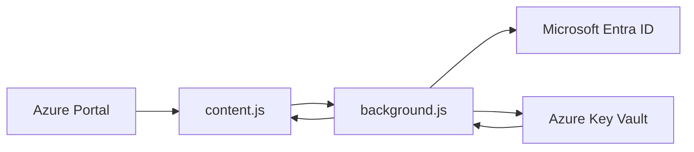

# Azure Key Vault Secret Revealer

A Chromium extension that adds inline Azure Key Vault secret values to the Azure Portal secret grids.

It can:

- reveal secret values directly in the Azure Portal list and version views;
- show secret version creation dates in the versions view;
- edit the current value and create a new secret version;
- keep older secret versions read-only;
- authenticate with Microsoft sign-in or a temporary pasted Key Vault access token.

This project is intended for users who already have valid Azure RBAC access to the target Key Vault. It does not bypass Azure permissions.

## Access Model

The extension cannot read, list, or update secrets by itself. Without a valid Microsoft Entra user session or pasted Key Vault access token, it is non-operable.

Access depends on all of the following:

- a valid Microsoft Entra identity or temporary bearer token;
- Azure RBAC data-plane permissions on the watched Key Vault;
- network access from the browser environment to Azure Portal and the target Key Vault endpoint.

If the signed-in user cannot access a vault in Azure, the extension cannot access it either.

## Safety Notice

This extension displays and edits secrets. Treat it as privileged tooling.

- Revealed secret values are visible in the page, screenshots, browser accessibility trees, and potentially screen-sharing sessions.
- Any user who can use this extension with your browser profile may be able to reveal secrets that your Azure identity can access.
- Editing the current value creates a new Key Vault secret version. It does not modify historical versions.
- Older versions are immutable in Azure Key Vault and are shown read-only by this extension.
- Use least privilege. Grant read/write permissions only to users who truly need them.
- Review your organization's policy before using browser extensions with production secrets.

## Features

### Secret List View

On a Key Vault secrets list page, the extension injects a `Value` column next to the secret name.

When hidden, values are masked.

When revealed, each secret value is fetched from Key Vault and shown in an input. If you edit the current value, a subtle green check button appears at the end of the input. Pressing that button saves the value as a new secret version.

### Secret Versions View

On a single secret's versions page, the extension injects:

- `Value`
- `Created date`

The current version is editable. Older versions are read-only and include a tooltip explaining that older versions cannot be changed.

### Toolbar Toggle

The extension adds a `Show Key Vault Secret Values` button to the Azure Portal command bar. Press it again to hide values.

### Authentication

The popup supports two auth modes:

- Microsoft sign-in using the extension's Entra application registration.
- Advanced fallback: paste a temporary Key Vault access token from Azure CLI.

## How It Works

The extension has three main parts:

- `manifest.json`: declares extension permissions, host access, popup, background worker, and content script.
- `background.js`: handles authentication and calls the Azure Key Vault data-plane API.
- `content.js`: detects Azure Portal Key Vault grids, injects columns, renders values, and sends fetch/save requests to the background worker.

Data flow:



The extension calls:

- `GET https://{vault}.vault.azure.net/secrets/{secretName}?api-version=7.4`
- `GET https://{vault}.vault.azure.net/secrets/{secretName}/{version}?api-version=7.4`
- `PUT https://{vault}.vault.azure.net/secrets/{secretName}?api-version=7.4`

The `PUT` call creates a new version of the secret.

## Requirements

- Google Chrome, Microsoft Edge, or another Chromium browser that supports Manifest V3.
- Access to `https://portal.azure.com`.
- Network access to the target Key Vault endpoint, including any firewall or private endpoint requirements.
- Azure Key Vault data-plane permissions for the signed-in Microsoft Entra user or pasted token.
- An Entra application registration for OAuth sign-in, unless you only use pasted temporary tokens.

## Azure Permissions

The extension uses delegated user permissions. It cannot independently discover, list, read, or write Key Vault secrets without an authenticated user or token that Azure accepts.

For reveal-only usage, the user needs permission to read secret values, such as:

- `secrets/get`
- usually `secrets/list` through portal use

For editing current values and creating new versions, the user also needs:

- `secrets/set`

Common built-in RBAC roles:

- `Key Vault Secrets User`: read secret contents.
- `Key Vault Secrets Officer`: manage secrets, including setting new values.

Use the narrowest role and scope that works. Prefer Key Vault-level or resource-group-level scope over subscription-level scope when possible.

## Entra App Registration Setup

The extension uses OAuth Authorization Code Flow with PKCE through `chrome.identity.launchWebAuthFlow`.

1. Go to Microsoft Entra ID in the Azure Portal.
2. Open `App registrations`.
3. Create a new app registration.
4. Use a public-client style registration. Do not create or use a client secret.
5. Add the extension redirect URI:

   ```text
   https://<extension-id>.chromiumapp.org/
   ```

6. Copy the Application client ID.
7. Set `CLIENT_ID` in `background.js`.

```js
const CLIENT_ID = "YOUR_APPLICATION_CLIENT_ID";
```

The current code uses:

```js
const TENANT_ID = "organizations";
const KEY_VAULT_SCOPE = "https://vault.azure.net/.default";
```

`organizations` allows work or school accounts. If your organization requires a single tenant, replace it with your tenant ID.

### Finding the Extension ID

After loading the unpacked extension:

1. Open `chrome://extensions` or `edge://extensions`.
2. Enable developer mode.
3. Find this extension.
4. Copy its ID.
5. Use that ID in the redirect URI:

   ```text
   https://<extension-id>.chromiumapp.org/
   ```

If the extension ID changes, update the redirect URI in the Entra app registration.

## Install Locally

1. Clone or download this repository.
2. Open `chrome://extensions` or `edge://extensions`.
3. Enable `Developer mode`.
4. Click `Load unpacked`.
5. Select this project folder.
6. Configure `CLIENT_ID` in `background.js`.
7. Reload the extension after changing code.

## Sign In

1. Open the extension popup.
2. Click `Sign in with Microsoft`.
3. Complete Microsoft sign-in.
4. The active Azure Portal tab reloads after auth updates.

If sign-in is not configured, the popup shows:

```text
Configure CLIENT_ID in background.js before signing in.
```

## Temporary Token Mode

The popup has an advanced option to paste a temporary Key Vault token.

Generate one with Azure CLI:

```powershell
az account get-access-token --resource https://vault.azure.net --query accessToken -o tsv
```

Paste it into the popup and click `Use pasted token`.

Notes:

- This is a fallback for local testing or special environments.
- The token is stored in `chrome.storage.session`.
- The popup text says the token is valid for about 30 minutes.
- Clear it from the popup when you are done.

## Usage Guide

### Reveal Secret Values

1. Open the Azure Portal.
2. Navigate to a Key Vault.
3. Open `Secrets`.
4. Click `Show Key Vault Secret Values` in the command bar.
5. Wait for values to load.

If a value cannot be fetched, the injected cell shows an error such as:

- `[Access denied]`
- `[Secret not found]`
- `[Token expired or invalid]`
- `[Key Vault request timed out]`

### Hide Secret Values

Click `Hide Key Vault Secret Values`.

This masks the injected values in the grid. It does not revoke Azure tokens or clear all browser memory. To fully stop access, sign out from the popup or close the browser session.

### Resize the Value Column

The injected `Value` column has a resize handle in the header. Drag it to widen or shrink the column.

### Create a New Secret Version

1. Reveal values.
2. Edit the current value input.
3. A green check appears at the end of the input.
4. Click the green check.
5. The extension calls Key Vault to create a new version.

The control shows:

- `Saving...`
- `Saved`
- or an error message

### Older Versions

Older versions are read-only. Azure Key Vault does not allow editing the value of an existing secret version.

To restore or reuse an older value:

1. Copy the older value.
2. Edit the current version value.
3. Save it as a new version.

## What Is Stored

The extension stores auth-related data, not secret values.

OAuth mode:

- Refresh token and account metadata are stored in `chrome.storage.local`.
- Access token is cached in the background service worker memory.

Temporary token mode:

- Pasted token is stored in `chrome.storage.session`.

Secret values:

- Values are fetched from Key Vault and rendered into the Azure Portal DOM when revealed.
- Values are cached in memory by the content script to avoid repeated fetches during the page session.
- Values are not intentionally written to extension local storage.

## Browser Permissions

The manifest requests:

- `storage`: store auth state and temporary token state.
- `activeTab`: reload the active Azure Portal tab after auth changes.
- `identity`: run Microsoft sign-in through browser identity APIs.

Host permissions:

- `https://portal.azure.com/*`: inject UI into Azure Portal.
- `https://*.vault.azure.net/*`: call Key Vault data-plane APIs.
- `https://login.microsoftonline.com/*`: request OAuth tokens.

## Security Concerns

### Secret Exposure

Once revealed, secret values are plain text in the page. They can be seen by:

- anyone looking at the screen;
- screen-sharing software;
- screenshots;
- browser accessibility tools;
- potentially other extensions with broad page access.

Keep values hidden unless needed.

### Editing Production Secrets

Saving a changed value creates a new active version. Applications that read the latest version may start using it immediately.

Before editing production secrets:

- confirm the target vault and secret name;
- confirm the current value;
- confirm application rollout expectations;
- confirm rollback steps;
- verify audit logging is enabled.

### RBAC Scope

Do not grant broad subscription-level write permissions just for convenience.

Use least privilege:

- read-only users should not have `secrets/set`;
- writers should be scoped to only the vaults they manage;
- review access regularly.

### Browser Profile Risk

OAuth refresh tokens live in browser extension storage. Protect the browser profile with normal endpoint controls.

Recommended:

- use a managed device;
- keep browser and OS updated;
- avoid shared profiles;
- sign out when done;
- remove the extension when no longer needed.

### Manual Tokens

Pasted tokens are bearer tokens. Anyone with the token can use it until it expires.

Do not paste tokens into chat, tickets, docs, or logs.

## Troubleshooting

### Button Does Not Appear

Check:

- you are on `https://portal.azure.com`;
- you are on a Key Vault secrets page;
- the extension is loaded and enabled;
- the page was refreshed after installing or signing in.

Azure Portal DOM changes can break grid detection. If the portal layout changes, `content.js` may need updates.

### Needs Sign-In

Open the popup and sign in.

If the popup says the client is not configured, set `CLIENT_ID` in `background.js` and reload the extension.

### Invalid Extension Client ID

Check:

- the Entra app registration exists;
- `CLIENT_ID` matches the Application client ID;
- the redirect URI uses the current extension ID;
- the redirect URI ends with `/`.

### Access Denied

Your identity or pasted token does not have the needed Key Vault data-plane permission.

For reveal:

- check `secrets/get`;
- check vault firewall and network restrictions;
- check tenant/account selection.

For save:

- check `secrets/set`.

### Token Expired Or Invalid

Sign in again or refresh the pasted token.

### Key Vault Request Timed Out

The extension times out network calls after 15 seconds. Retry after checking:

- network connectivity;
- vault firewall rules;
- private endpoint access;
- Azure service health.

### Values Do Not Refresh After Save

The extension clears its in-memory cache after saving and schedules a grid refresh. If the Azure Portal grid does not update:

1. Refresh the Azure Portal tab.
2. Hide and show values again.
3. Reopen the secret versions page.

## Development

This repo is plain JavaScript and Manifest V3. There is no build step and no package manager configuration.

Useful local checks:

```powershell
node --check .\content.js
node --check .\background.js
node --check .\popup.js
```

After editing:

1. Go to `chrome://extensions` or `edge://extensions`.
2. Click reload on the unpacked extension.
3. Refresh Azure Portal.
4. Test sign-in, reveal, hide, save, older-version read-only behavior, and popup sign-out.

## Project Files

- `manifest.json`: extension metadata, permissions, content script, popup, and background service worker.
- `background.js`: OAuth, token storage, Key Vault GET and PUT calls.
- `content.js`: Azure Portal DOM detection, injected toolbar button, grid columns, editable values, read-only older versions.
- `popup.html`: popup UI.
- `popup.js`: popup auth actions and status rendering.
- `icons/`: extension icons.

## Known Limitations

- Azure Portal DOM structure is not a stable public API. Portal updates may break detection or injection.
- The extension only runs on `portal.azure.com`.
- It is designed for Chromium Manifest V3 browsers.
- It does not list or manage deleted secrets.
- It does not edit existing historical versions because Key Vault versions are immutable.
- It does not provide a confirmation dialog before saving a new version.
- It does not package or publish the extension to a browser store.
- It does not replace Azure audit logs, access reviews, or formal secret-management workflows.

## Recommended Operational Practices

- Use separate development/test/prod vaults.
- Keep production write access limited.
- Enable Key Vault diagnostic logs.
- Review `SecretGet` and `SecretSet` activity.
- Prefer named versions or deployment records in application change logs.
- Rotate secrets through normal operational processes.
- Remove stale secret versions according to your retention policy.

## References

- [Azure Key Vault REST API](https://learn.microsoft.com/rest/api/keyvault/)
- [Azure Key Vault secrets](https://learn.microsoft.com/azure/key-vault/secrets/)
- [Azure built-in roles for Key Vault](https://learn.microsoft.com/azure/key-vault/general/rbac-guide)
- [Chrome extensions: identity API](https://developer.chrome.com/docs/extensions/reference/api/identity)
- [Chrome extensions: Manifest V3](https://developer.chrome.com/docs/extensions/develop/migrate/what-is-mv3)

## Disclaimer

This extension is powerful because it uses your Azure identity to reveal and update secrets. Review the code, test in non-production vaults first, and make sure usage is allowed by your organization before using it with sensitive environments.
