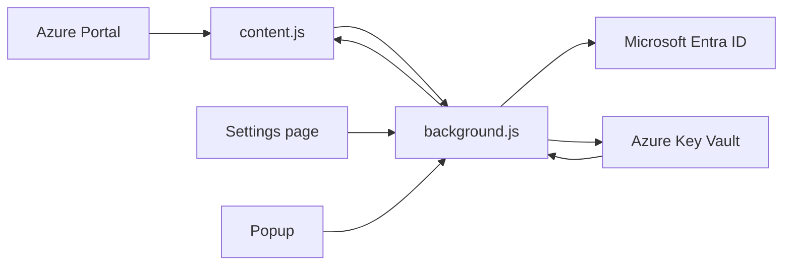

# Development

This repo is plain JavaScript and Manifest V3. There is no build step and no package manager configuration.

## How it works

The extension has four main parts:

- `manifest.json`: declares extension permissions, host access, popup, settings page, background worker, and content script.
- `background.js`: handles settings, authentication, and calls the Azure Key Vault data-plane API.
- `content.js`: detects Azure Portal Key Vault grids, auto-loads all rows, injects columns, the search box, and the create-secret panel, handles name sorting, renders values, and sends fetch/save requests to the background worker.
- `popup.html` / `popup.js` and `options.html` / `options.js`: the toolbar popup and the settings page.

Data flow:



The extension calls:

- `GET https://{vault}.vault.azure.net/secrets/{secretName}?api-version=7.4`
- `GET https://{vault}.vault.azure.net/secrets/{secretName}/{version}?api-version=7.4`
- `GET https://{vault}.vault.azure.net/secrets?api-version=7.4`
- `PUT https://{vault}.vault.azure.net/secrets/{secretName}?api-version=7.4`

The `PUT` call creates the secret when the name is new, or a new version of an existing secret.

### Settings flow

The service worker holds the client ID and tenant in two variables, both empty until saved. Every message handler waits for `ensureConfig()`, which reads `kvConfigClientId` and `kvConfigTenantId` from `chrome.storage.local` once per worker start. A failed read is retried on the next message and never treated as "not configured".

Message actions used by the settings page:

| Action | Sender | Effect |
|---|---|---|
| `getConfig` | extension pages only | Returns `configured`, `clientId`, `tenantId`, `redirectUri`. |
| `saveConfig` | extension pages only | Validates both values (GUID, tenant also accepts `organizations`), stores them, signs out if they changed. |
| `clearConfig` | extension pages only | Removes both values, signs out. |

`isExtensionPage(sender)` checks that the sender URL starts with `chrome-extension://<id>/`. Content scripts report the portal's URL, so they are rejected.

`isAppConfigured()` gates sign-in, token refresh, and `signedIn` in the auth status, so a refresh token left over from before configuration never counts as a session.

On a fresh install (`onInstalled` reason `install`) the worker opens the settings page.

## Project files

- `manifest.json`: extension metadata, permissions, content script, popup, settings page, and background service worker.
- `background.js`: settings, OAuth, token storage, Key Vault list, GET, and PUT calls.
- `content.js`: Azure Portal DOM detection, injected toolbar button, grid columns, editable values, read-only older versions.
- `popup.html`: popup UI.
- `popup.js`: popup auth actions and status rendering.
- `options.html`: settings page UI.
- `options.js`: settings page: loads, validates, and saves the app registration values.
- `icons/`: extension icons. `icon512.png` is not packaged; use it for store artwork.
- `scripts/package.mjs`: builds the Chrome Web Store ZIP.
- `PRIVACY.md`: privacy policy for the Chrome Web Store listing.
- `docs/`: documentation. `docs/privacy.html` is the privacy policy as a standalone page for GitHub Pages or another host.

## Local checks

```powershell
node --check .\content.js
node --check .\background.js
node --check .\popup.js
node --check .\options.js
node --check .\scripts\package.mjs
```

## After editing

1. Go to `chrome://extensions` or `edge://extensions`.
2. Click reload on the unpacked extension.
3. Refresh Azure Portal.
4. Test sign-in, reveal, hide, save, export, malformed import rejection, import preview/cancel, import into new and existing names, older-version read-only behavior, and popup sign-out.
5. Test the settings page: save an invalid and a valid client ID, confirm the sign-out after a change, confirm an unchanged save keeps the session, and use `Clear settings`.

## Build the store package

```powershell
node .\scripts\package.mjs
```

This writes `dist/az-kv-secret-revealer-<version>.zip`. It needs Node.js 18 or later and nothing else. The ZIP contains only `manifest.json`, `background.js`, `content.js`, `popup.html`, `popup.js`, `options.html`, `options.js`, and the 16/32/48/128 icons. The packaged `manifest.json` has no `key` field. `keys/`, `bin/`, `.crx` files, docs, and dev files are never included.

Bump `version` in `manifest.json` before each upload. The store rejects a version it has already seen. The script fails if the manifest references a file that is not in its allowlist, so a new page or script must be added to `RUNTIME_FILES` in `scripts/package.mjs`.

To publish, see [Publishing](publishing.md).

## Known limitations

- Azure Portal DOM structure is not a stable public API. Portal updates may break detection or injection.
- The extension only runs on `portal.azure.com`.
- It is designed for Chromium Manifest V3 browsers.
- It does not list or manage deleted secrets.
- It does not edit existing historical versions because Key Vault versions are immutable.
- It does not provide a confirmation dialog before saving a new version or creating a secret.
- The duplicate-name check on create only sees rows already loaded in the grid.
- Export and import use plaintext JSON files by design.
- It does not replace Azure audit logs, access reviews, or formal secret-management workflows.
- There is no built-in app registration. Every install needs its own client ID and tenant.

## References

- [Azure Key Vault REST API](https://learn.microsoft.com/rest/api/keyvault/)
- [Azure Key Vault secrets](https://learn.microsoft.com/azure/key-vault/secrets/)
- [Azure built-in roles for Key Vault](https://learn.microsoft.com/azure/key-vault/general/rbac-guide)
- [Chrome extensions: identity API](https://developer.chrome.com/docs/extensions/reference/api/identity)
- [Chrome extensions: Manifest V3](https://developer.chrome.com/docs/extensions/develop/migrate/what-is-mv3)
